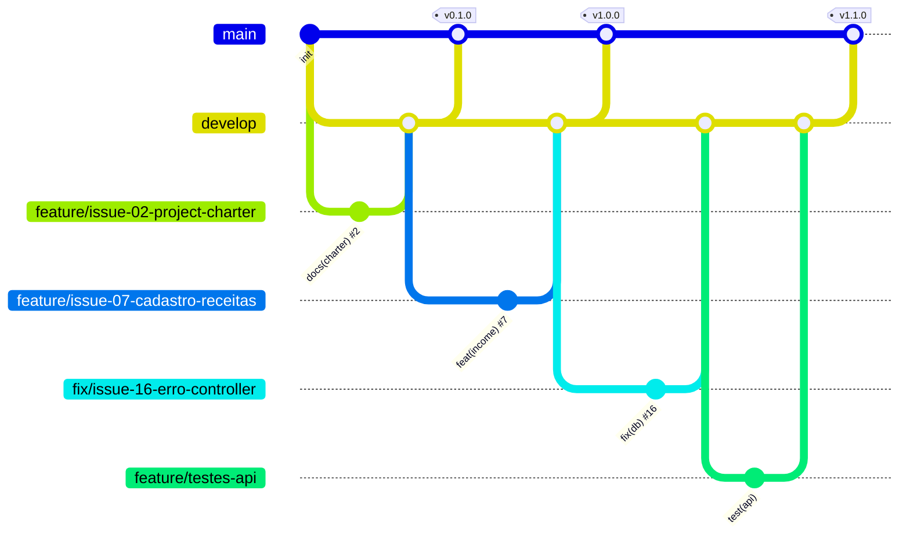

# 💰 Segura a Grana

[](https://github.com/Rejane-prog/segura-a-grana/actions/workflows/ci.yml)
[](https://github.com/Rejane-prog/segura-a-grana/actions/workflows/seguranca.yml)

[](LICENSE)


Controle simples de finanças pessoais para registrar receitas e despesas e acompanhar o saldo.

## 📌 Problema
Eu gasto muito e, no fim do mês, acabo nem sabendo para onde foi o meu dinheiro, aí passo sufoco. O **Segura a Grana** nasceu dessa necessidade: um jeito prático de registrar tudo o que entra e sai e ver o saldo na hora.

## ✅ Funcionalidades
| Funcionalidade | Requisito | Issue | Status | Teste |
|---|---|---|---|---|
| Cadastrar receitas | RF01 | #7 | ✅ Implementado | ✅ |
| Cadastrar despesas | RF02 | #8 | ✅ Implementado | ✅ |
| Listar movimentações | RF03 | #9 | ✅ Implementado | ✅ |
| Editar movimentação | RF04 | #10 | ✅ Implementado | ✅ |
| Excluir movimentação | RF05 | #11 | ✅ Implementado | ✅ |
| Categorias | RF06 | #12 | ✅ Implementado | ✅ |
| Saldo atual | RF07 | #13 | ✅ Implementado | ✅ |
| Filtro por tipo | RF08 | #14 | ✅ Implementado | ✅ |
| Validação dos dados | RNF03 | #41 | ✅ Implementado | ✅ |
| Desempenho com 5 000 registros | RNF04 | #42 | ✅ Medido | ✅ |

"Implementado" significa que existe teste automatizado passando no CI. Veja a [matriz de rastreabilidade](docs/requisitos.md).

### 🔜 Planejado (roadmap com issues abertas)
- Gráficos de gastos por categoria
- Login de usuários
- Contas recorrentes e parcelas
- Lint/format, logs estruturados, Docker e checklist de acessibilidade

## 🛠️ Tecnologias
Node.js 22.13+ · Express · SQLite (módulo nativo `node:sqlite`) · HTML · CSS · JavaScript · `node:test` · GitHub Actions

## 🗂️ Estrutura
```text
segura-a-grana/
├── .github/
│   ├── workflows/           # CI (testes) e segurança (gitleaks + npm audit)
│   ├── ISSUE_TEMPLATE/      # modelos de issue
│   ├── dependabot.yml
│   └── pull_request_template.md
├── docs/                    # documentação de engenharia
├── src/
│   ├── server.js            # sobe o servidor
│   ├── app.js               # configura o Express
│   ├── database.js          # conexão e tabela SQLite
│   ├── routes/              # rotas da API
│   ├── middlewares/         # validação (RNF03)
│   ├── controllers/         # regras de negócio
│   └── public/              # interface (HTML, CSS, JS)
├── test/                    # testes automatizados
├── .env.example
├── CHANGELOG.md
├── CONTRIBUTING.md
├── LICENSE
└── package.json
```

## 🚀 Como executar
**Pré-requisitos:** Node.js 22.13 ou superior e Git.

```bash
# 1. Clonar o repositório
git clone https://github.com/Rejane-prog/segura-a-grana.git
cd segura-a-grana

# 2. Instalar as dependências
npm install

# 3. (Opcional) Configurar variáveis de ambiente
cp .env.example .env        # no Windows: copy .env.example .env

# 4. Executar
npm start
```
Acesse **http://localhost:3000**. O banco é criado automaticamente na primeira execução.

> **Windows:** se o PowerShell bloquear o `npm`, use `npm.cmd install`, `npm.cmd start` e `npm.cmd test`.
> O aviso `ExperimentalWarning: SQLite is an experimental feature` pode ser ignorado.

### Variáveis de ambiente
| Variável | Padrão | Descrição |
|---|---|---|
| `PORT` | `3000` | Porta do servidor |
| `DB_PATH` | `segura-a-grana.db` | Arquivo do banco SQLite |

## 🧪 Testes
```bash
npm test
```
- **35 testes** com o executor nativo `node:test`, usando banco em memória.
- Cobrem RF01–RF08, a validação (RNF03) e o desempenho com 5 000 movimentações (RNF04).
- Rodam automaticamente no **GitHub Actions** a cada push e Pull Request (Node 22 e 24).

## 🔌 API
| Método | Rota | Descrição |
|---|---|---|
| GET | `/api/movimentacoes?tipo=` | Lista (filtro opcional: receita/despesa) |
| POST | `/api/movimentacoes` | Cadastra |
| PUT | `/api/movimentacoes/:id` | Edita |
| DELETE | `/api/movimentacoes/:id` | Exclui |
| GET | `/api/movimentacoes/saldo` | Receitas, despesas e saldo |

Erros seguem sempre o formato `{ "erro": "mensagem", "campos": ["valor"] }`.

## 📚 Documentação
- [Índice da documentação](docs/README.md)
- [Project Charter](docs/project-charter.md)
- [Requisitos e rastreabilidade](docs/requisitos.md)
- [Casos de Uso](docs/casos-de-uso.md)
- [User Stories](docs/user-stories.md)
- [Arquitetura](docs/arquitetura.md)
- [Modelo de Dados](docs/modelo-dados.md)
- [Backlog inicial](docs/issues.md)
- [Como contribuir](CONTRIBUTING.md) · [Changelog](CHANGELOG.md)

## 🌿 Fluxo de branches (Git Flow)
| Branch | Uso |
|---|---|
| `main` | Versões estáveis, marcadas com tags |
| `develop` | Integração do desenvolvimento |
| `feature/issue-N-nome` | Funcionalidades, testes e documentação, a partir da `develop` |
| `fix/issue-N-nome` | Correções de bugs, a partir da `develop` |
| `release/vX.Y.Z` | Preparação de versão |



**Commits:** Conventional Commits, ex.: `test(api): cobrir RF01 a RF08 (#18)` · **PRs:** sempre para a `develop`, com `Closes #N`. Detalhes no [CONTRIBUTING](CONTRIBUTING.md).

## 🏷️ Versões
| Versão | Marco |
|---|---|
| v0.1.0 | Estrutura e documentação |
| v0.2.0 | Banco, cadastro e listagem |
| v0.3.0 | Edição, exclusão, categorias, saldo e filtro |
| v1.0.0 | Versão final documentada |
| v1.0.1 | Correções após merge e SQLite nativo (#16) |
| v1.1.0 | Testes, validação, CI, segurança e governança (Week_02) |

Histórico completo no [CHANGELOG](CHANGELOG.md).

## 👩‍💻 Autora
Rejane Ferreira de Mendonça · [@Rejane-prog](https://github.com/Rejane-prog)

## 📄 Licença
Distribuído sob a licença MIT. Veja [LICENSE](LICENSE).
