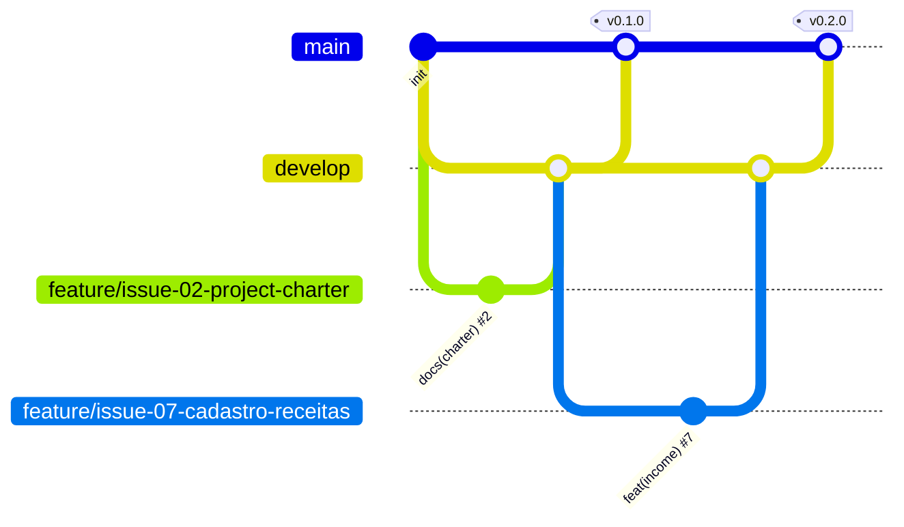

# 💰 Segura a Grana


Controle simples de finanças pessoais para registrar receitas e despesas e acompanhar o saldo.

## 📌 Problema
Muita gente termina o mês sem saber para onde foi o dinheiro. O **Segura a Grana** ajuda a registrar entradas e saídas de forma rápida e mostra o saldo na hora.

## ✅ Funcionalidades
| Funcionalidade | Requisito | Issue | Status |
|---|---|---|---|
| Cadastrar receitas | RF01 | #7 | ✅ Implementado |
| Cadastrar despesas | RF02 | #8 | ✅ Implementado |
| Listar movimentações | RF03 | #9 | ✅ Implementado |
| Editar movimentação | RF04 | #10 | ✅ Implementado |
| Excluir movimentação | RF05 | #11 | ✅ Implementado |
| Categorias | RF06 | #12 | ✅ Implementado |
| Saldo atual | RF07 | #13 | ✅ Implementado |
| Filtro por tipo | RF08 | #14 | ✅ Implementado |

### 🔜 Planejado para próximas versões
- Login de usuários
- Gráficos de gastos por categoria
- Contas recorrentes e parcelas

## 🛠️ Tecnologias
Node.js · Express · SQLite (better-sqlite3) · HTML · CSS · JavaScript

## 🗂️ Estrutura
```text
segura-a-grana/
├── docs/                    # documentação do projeto
├── src/
│   ├── server.js            # servidor Express
│   ├── database.js          # conexão e tabela SQLite
│   ├── routes/              # rotas da API
│   ├── controllers/         # regras de negócio
│   └── public/              # interface (HTML, CSS, JS)
├── .gitignore
├── package.json
└── README.md
```

## 🚀 Como executar
**Pré-requisitos:** Node.js 20+ e Git.

```bash
# 1. Clonar o repositório
git clone https://github.com/SEU-USUARIO/segura-a-grana.git
cd segura-a-grana

# 2. Instalar as dependências
npm install

# 3. Executar
npm start
```
Depois acesse **http://localhost:3000**. O banco `segura-a-grana.db` é criado automaticamente.

## 🔌 API
| Método | Rota | Descrição |
|---|---|---|
| GET | `/api/movimentacoes?tipo=` | Lista (filtro opcional: receita/despesa) |
| POST | `/api/movimentacoes` | Cadastra |
| PUT | `/api/movimentacoes/:id` | Edita |
| DELETE | `/api/movimentacoes/:id` | Exclui |
| GET | `/api/movimentacoes/saldo` | Receitas, despesas e saldo |

## 📚 Documentação
- [Project Charter](docs/project-charter.md)
- [Requisitos (RF e RNF)](docs/requisitos.md)
- [Casos de Uso](docs/casos-de-uso.md)
- [User Stories](docs/user-stories.md)
- [Modelo de Dados](docs/modelo-dados.md)
- [Backlog de Issues](docs/issues.md)

## 🌿 Fluxo de branches (Git Flow)
| Branch | Uso |
|---|---|
| `main` | Versões estáveis (com tags) |
| `develop` | Integração do desenvolvimento |
| `feature/issue-XX-nome` | Uma branch por issue, criada a partir da `develop` |



**Commits:** padrão Conventional Commits, ex.: `feat(income): implementar cadastro de receitas (#7)`
**Pull Requests:** sempre para a `develop`, com `Closes #N`.

## 🏷️ Versões
| Versão | Marco |
|---|---|
| v0.1.0 | Estrutura e documentação |
| v0.2.0 | Banco, cadastro e listagem |
| v0.3.0 | Edição, exclusão, categorias, saldo e filtro |
| v1.0.1 | Versão final documentada |

## 👩‍💻 Autora
Rejane Ferreira de Mendonça
