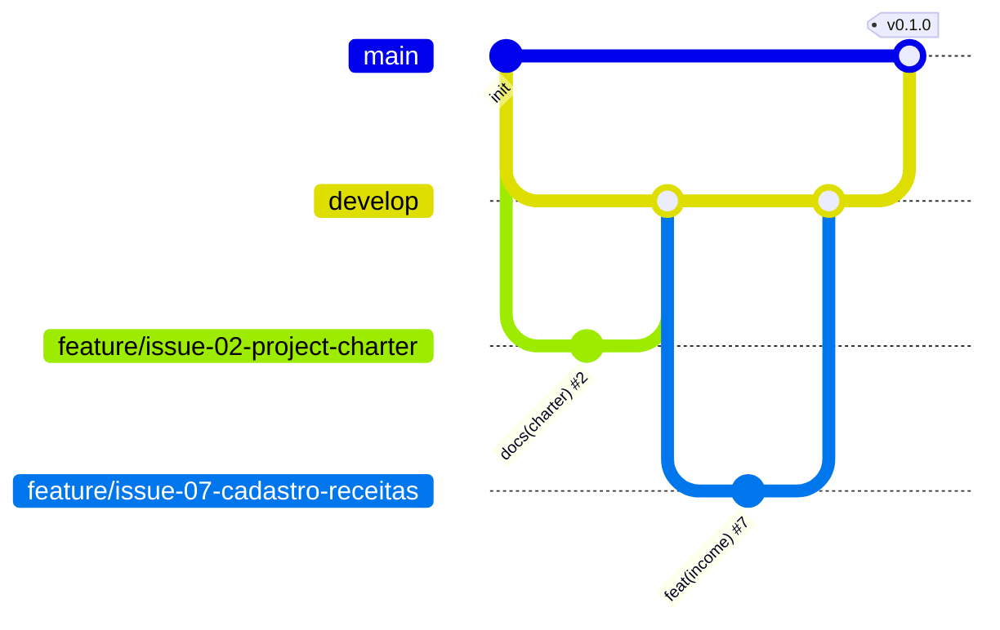

# 💰 Segura a Grana


Controle simples de finanças pessoais para registrar receitas e despesas e acompanhar o saldo.

## 📌 Problema
Muita gente termina o mês sem saber para onde foi o dinheiro. O **Segura a Grana** ajuda a registrar entradas e saídas de forma rápida e mostra o saldo na hora.

## ✅ Funcionalidades
| Funcionalidade | Requisito | Status |
|---|---|---|
| Cadastrar receitas | RF01 | 🔲 Planejado |
| Cadastrar despesas | RF02 | 🔲 Planejado |
| Listar movimentações | RF03 | 🔲 Planejado |
| Editar movimentação | RF04 | 🔲 Planejado |
| Excluir movimentação | RF05 | 🔲 Planejado |
| Categorias | RF06 | 🔲 Planejado |
| Saldo atual | RF07 | 🔲 Planejado |
| Filtro por tipo | RF08 | 🔲 Planejado |

> Atualize para ✅ Implementado conforme as issues forem fechadas.

## 🛠️ Tecnologias
Node.js · Express · SQLite · HTML · CSS · JavaScript

## 🚀 Como executar
```bash
# 1. Clonar o repositório
git clone https://github.com/SEU-USUARIO/segura-a-grana.git
cd segura-a-grana

# 2. Instalar dependências
npm install

# 3. Executar
npm start

# 4. Acessar
http://localhost:3000
```
**Pré-requisitos:** Node.js 18+ e Git.

## 📚 Documentação
- [Project Charter](docs/project-charter.md)
- [Requisitos (RF e RNF)](docs/requisitos.md)
- [Casos de Uso](docs/casos-de-uso.md)
- [User Stories](docs/user-stories.md)
- [Modelo de Dados](docs/modelo-dados.md)
- [Backlog de Issues](docs/issues.md)

## 🌿 Fluxo de branches (Git Flow)
| Branch | Uso |
|---|---|
| `main` | Versões estáveis (com tags) |
| `develop` | Integração do desenvolvimento |
| `feature/issue-XX-nome` | Uma branch por issue, criada a partir da `develop` |



**Commits:** padrão Conventional Commits, ex.: `feat(income): implementar cadastro de receitas (#7)`
**PRs:** sempre com `Closes #N`.

## 🏷️ Versões
| Versão | Marco |
|---|---|
| v0.1.0 | Estrutura e documentação |
| v0.2.0 | Cadastro e listagem |
| v0.3.0 | Edição, exclusão, categorias e filtro |
| v1.0.0 | Versão final |

## 👩‍💻 Autora
Rejane Ferreira de Mendonça
