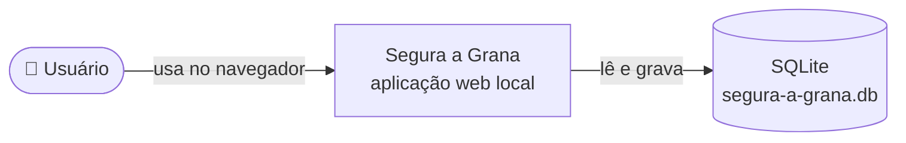
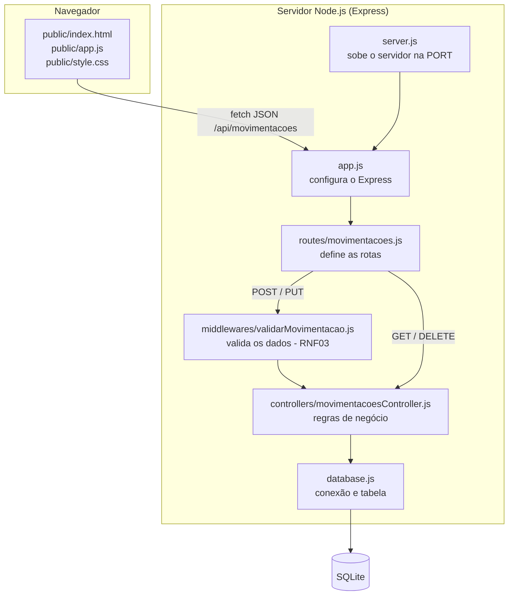
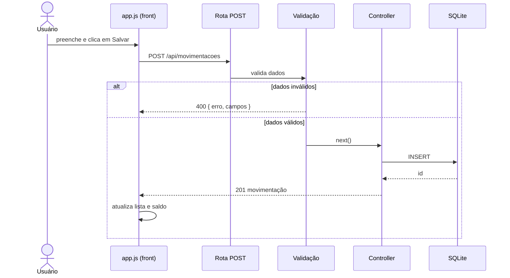

# Arquitetura – Segura a Grana

## 1. Visão geral
Aplicação web monolítica e local, em **camadas**: a interface (HTML/CSS/JS) conversa com uma API REST em Node.js + Express, que grava os dados em SQLite.

## 2. Diagrama de contexto (C4 – nível 1)

## 3. Diagrama de componentes (C4 – nível 3)

## 4. Camadas e responsabilidades
| Camada | Arquivo | Responsabilidade |
|---|---|---|
| Apresentação | `src/public/*` | Formulário, lista, filtro e resumo do saldo. Chama a API com `fetch`. |
| Inicialização | `src/server.js` | Lê `PORT` e sobe o servidor. |
| Aplicação | `src/app.js` | Configura JSON, arquivos estáticos e rotas. É exportado para os testes. |
| Rotas | `src/routes/movimentacoes.js` | Liga cada URL e método HTTP ao controller. |
| Validação | `src/middlewares/validarMovimentacao.js` | Barra dados inválidos antes do controller e padroniza o erro. |
| Negócio | `src/controllers/movimentacoesController.js` | Cadastrar, listar, filtrar, editar, excluir, categorizar e calcular saldo. |
| Persistência | `src/database.js` | Abre o SQLite (`DB_PATH`) e cria a tabela. |

## 5. Fluxo de uma requisição (cadastro)

## 6. API
| Método | Rota | Resposta |
|---|---|---|
| GET | `/api/movimentacoes?tipo=` | 200 lista |
| POST | `/api/movimentacoes` | 201 criada · 400 inválida |
| PUT | `/api/movimentacoes/:id` | 200 · 400 · 404 |
| DELETE | `/api/movimentacoes/:id` | 204 · 404 |
| GET | `/api/movimentacoes/saldo` | 200 `{ receitas, despesas, saldo }` |

**Formato de erro padrão:** `{ "erro": "mensagem", "campos": ["valor"] }`

## 7. Modelo de dados
Tabela única `movimentacoes`. Detalhes em [modelo-dados.md](modelo-dados.md).

## 8. Decisão de arquitetura (ADR-001): banco de dados
| Opção | Prós | Contras |
|---|---|---|
| **SQLite nativo (`node:sqlite`)** ✅ | Zero instalação, sem compilação, arquivo único, ideal para uso local | Recurso ainda marcado como experimental no Node |
| `better-sqlite3` | Maduro e rápido | Precisa de binário compilado; falhou no Windows corporativo (#16) |
| PostgreSQL | Robusto e multiusuário | Exige servidor, desnecessário para uso pessoal local |

**Decisão:** SQLite nativo do Node, por atender RNF02 (persistência) e RNF05 (portabilidade) sem dependências nativas.

## 9. Decisão de arquitetura (ADR-002): ferramenta de testes
| Opção | Prós | Contras |
|---|---|---|
| **`node:test` + `fetch` nativo** ✅ | Já vem no Node, zero dependências, roda igual no CI | Menos recursos que o Jest |
| Jest + Supertest | Muito popular, bons relatórios | Duas dependências a mais para instalar e manter |

**Decisão:** `node:test`, mantendo o projeto com apenas uma dependência (Express). Os testes seguem a mesma estrutura de `describe`/`test` do Jest, então a migração é simples se for necessária.

## 10. Configuração
| Variável | Padrão | Uso |
|---|---|---|
| `PORT` | `3000` | Porta do servidor |
| `DB_PATH` | `segura-a-grana.db` | Arquivo do banco (`:memory:` nos testes) |
