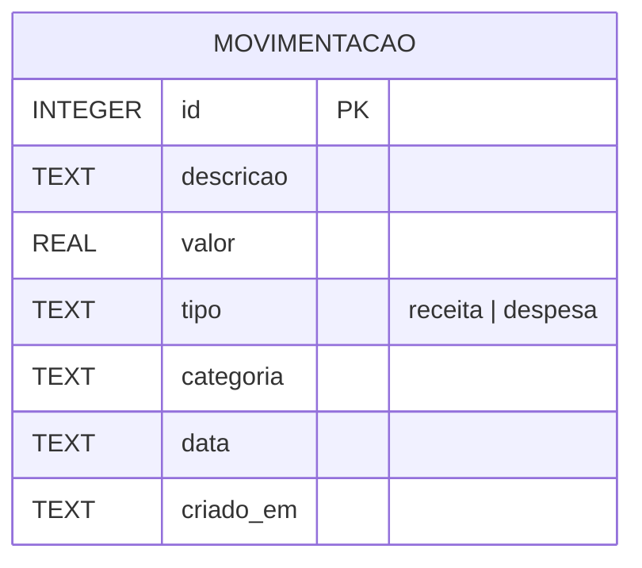

# Modelo de Dados – Segura a Grana

| Campo | Tipo | Obrigatório | Observação |
|---|---|---|---|
| id | INTEGER | Sim | Chave primária autoincremento |
| descricao | TEXT | Sim | Ex.: "Mercado" |
| valor | REAL | Sim | Maior que zero |
| tipo | TEXT | Sim | `receita` ou `despesa` |
| categoria | TEXT | Não | Padrão "Outros" |
| data | TEXT | Sim | Formato AAAA-MM-DD |
| criado_em | TEXT | Sim | Gerado automaticamente |
